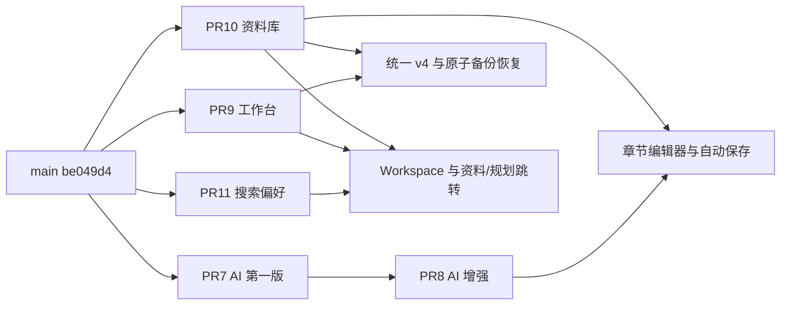

# StoryForge 多分支集成审查报告

审查日期：2026-10-16（UTC）。对象：shawnhhh/storyforge，PR #7–#11 与实时 main。

## 1. 结论与适用范围

五个 PR 单独 CI 成功，但不能据此直接整体合并。实际组合发现迁移版本冲突、备份结构歧义、共享工作台冲突和移动端布局问题，已在独立分支 `integration/pr7-11-review-20261016` 处理。没有修改原功能分支、main，也没有合并任何远程 PR。

本次固定基线为 **`be049d4545c041f3635f4d8e83517cb1fd16e5a0`**。下列五个 head 与 main 已通过远程引用复核，未发生漂移；结论只适用于这些提交和本集成分支的修复。未来提交必须重新比较差异和重测受影响链路。

最终本地验证：lint、包含三组 TypeScript 检查的 build 通过；单元/API **106/106，零跳过**；完整 Chromium E2E **57/57，失败 0、跳过 0，约 7.0 分钟**。Mac Safari、真实输入法和真实 AI 服务未验证。

本报告与完整功能组合将通过 Draft PR 供审阅，**不代表已获准合并**。Draft PR：[本集成分支的 Draft PR](https://github.com/shawnhhh/storyforge/pulls?q=is%3Apr+head%3Aintegration%2Fpr7-11-review-20261016)（最终交付附直接链接）。

## 2. GitHub 实时快照与 CI

首次快照保留在 [github-snapshot.json](integration-review/github-snapshot.json)，结束时的 SHA 复核见 [refs-verified.tsv](integration-review/refs-verified.tsv)。PR CI 已读取 GitHub 实际 job steps 和日志中的计数，未采用 PR 描述替代验证。

| PR | 最新 head SHA | 目标分支 | 当前状态 | 变更文件 | 最新 PR CI | CI 单元/API；E2E |
| --- | --- | --- | --- | ---: | --- | --- |
| [#7](https://github.com/shawnhhh/storyforge/pull/7) AI 第一版 | `8d7790367ecd7518aefb9df9ddba34bfe080e0db` | main | Open，非 Draft，未合并 | 19 | [成功](https://github.com/shawnhhh/storyforge/actions/runs/38750399032) | 76/76；37/37 |
| [#8](https://github.com/shawnhhh/storyforge/pull/8) AI 增强 | `8b751a33f27588cfb589d6decf38c4fb6585a4ab` | feat/ai-writing | Open，Draft，未合并 | 25 | [成功](https://github.com/shawnhhh/storyforge/actions/runs/38836991636) | 82/82；40/40 |
| [#9](https://github.com/shawnhhh/storyforge/pull/9) 创作工作台 | `d290f910f795ef5eddac91699653eb4e2e1d8d6d` | main | Open，Draft，未合并 | 27 | [成功](https://github.com/shawnhhh/storyforge/actions/runs/38837537273) | 76/76；33/33 |
| [#10](https://github.com/shawnhhh/storyforge/pull/10) 创作资料库 | `981a39bfd7e165fd60d1d4c01ae5ae751f19deb6` | main | Open，Draft，未合并 | 29 | [成功](https://github.com/shawnhhh/storyforge/actions/runs/38838625482) | 78/78；29/29 |
| [#11](https://github.com/shawnhhh/storyforge/pull/11) 搜索与偏好 | `7b3b784a840616720e461f1c3aed05c1d7eacb85` | main | Open，Draft，未合并 | 19 | [成功](https://github.com/shawnhhh/storyforge/actions/runs/38838745721) | 75/75；30/30 |

所有列出的 CI 日志均为零失败、零跳过。job steps 中的“Upload browser failure diagnostics”被跳过是成功后的条件步骤，不是跳过测试。#11 描述提及开发期 29/30 后定向复跑，但其最新 GitHub CI 日志是一次完整 **30/30**。

#8 的 base SHA 为 #7 head `8d77903`；其余 PR 的 base SHA 均为上述 main。#8 head 包含 #7 的提交，依赖真实存在。GitHub 查询时五项 `mergeable=true` 仅针对各自目标分支，不涵盖其他四项组合。

main 的 legacy commit status 列表为空；现有工作流连接器仅返回 PR 触发的工作流，对 main SHA 返回空列表，命令行 GitHub REST 访问被网络策略拒绝。因此 **main 的独立 push 工作流状态未验证**，不能将“空列表”解释为成功。集成版实际包含该 main 并执行了完整验证。

证据：[CI steps](integration-review/ci-jobs.json)、[CI 日志实测计数](integration-review/ci-observed-counts.json)。

## 3. 文件冲突矩阵与依赖

下表为“PR 声明增量的重叠文件数 / 两个完整 head 的实际冲突文件数”。两两探测使用独立 clone 中的 `git merge-tree --write-tree`，未改动原工作区。完整路径清单见 [conflict-matrix.json](integration-review/conflict-matrix.json)。

| 组合 | 重叠 / 冲突 | 主要位置及含义 |
| --- | --- | --- |
| #7 × #8 | 13 / 0 | AI 配置、契约、组件、测试；#7 是 #8 的祖先 |
| #7 × #9 | 3 / 1 | README 冲突；app 注册与人物排序测试重叠 |
| #7 × #10 | 5 / 2 | app、Playwright 配置冲突；ChapterEditor 自动合并后仍需验证 AI 与 children 共存 |
| #7 × #11 | 4 / 3 | app、人物测试、Playwright 配置 |
| #8 × #9 | 1 / 1 | README；#8 同时继承 #7 的修改 |
| #8 × #10 | 1 / 2 | app、Playwright 冲突来自继承的 #7 代码 |
| #8 × #11 | 1 / 3 | app、人物测试、Playwright 冲突来自继承的 #7 代码 |
| #9 × #10 | 10 / 9 | migrate、备份 service、Workspace、app、四组旧版本测试、迁移说明 |
| #9 × #11 | 4 / 1 | Workspace 首页、状态、入口和页面布局 |
| #10 × #11 | 6 / 4 | Workspace、StoryBiblePanel、README、Playwright 配置 |

真实顺序合并为 **main → #7 → #8 → #9 → #10 → #11**：#7/#8 无冲突；#9 解决 README；#10 解决 10 个文件；#11 解决 6 个文件。与两两矩阵的差异来自前面已组合的改动。没有使用整文件 `ours/theirs` 丢弃另一模块。



功能前置只有 #8 → #7；联合发布还必须协调 #9/#10 的数据库结构以及 #9/#10/#11 的共享 Workspace。

## 4. 已验证问题与修复

| 等级 | 问题 | 集成修复与验证 |
| --- | --- | --- |
| 高 / 合并阻塞 | #9 与 #10 各将不同结构记录为基础 v3 | 统一为 v3 工作台、v4 资料库；将资料库 SQL 登记为 `0004_knowledge.sql`。精确识别历史两类 v3 的模块 DDL、索引和触发器，事务内补齐缺失模块。残缺/手工混合 v3 拒绝升级，保留原数据 |
| 高 / 合并阻塞 | 同一个 v3 备份版本号无法区分工作台与资料库，简单选一侧可能拒绝合法备份或遗漏表 | 使用精确完整 schema 签名集合，支持 v1、v2、两类 v3、v4 × 有/无 planning/001，共十种结构。只迁移私有恢复副本；恢复统一包含章节、资料、引用、规划、目标、活动和迁移记录 |
| 高 / 合并阻塞 | Workspace 冲突可能丢失继续写作章节、资料引用、搜索定位或未保存阻止逻辑 | 合并 Dashboard、ChapterReferences、searchTarget/materialId、偏好与模块导航；切小说清理旧定位。保留原 ChapterSaver，切章先排空保存队列，失败阻止离开 |
| 中 | 搜索与资料库各自扩展 StoryBiblePanel 的 initialId/props | 保留 library 模式与 chapters/onOpen，同时支持搜索定位；类型检查和精确章节/人物/设定/规划跳转测试通过 |
| 中 | #9 的 `prefers-color-scheme` 样式忽略 #11 的手动主题 | Dashboard 深色样式统一使用 `data-theme`；系统深色→手动浅色、系统浅色→手动深色和手机入口的组合 E2E 通过 |
| 中 | 新侧栏按钮让规划页原 145px 手机高度溢出，主区截获小说列表点击 | 调整规划侧栏可用高度、行间距、导航高度，并让 Dashboard 的搜索/偏好独占手机网格行。390px 规划故障恢复与切小说定向回归通过 |
| 测试适配 | AI 700px 测试寻找 Dashboard 已替换的“创建小说”入口 | 测试从可见“新建作品”入口创建；继续保留编辑器 DOM、选区、滚动、预览/接受/撤销全部断言 |
| 测试适配 | “未来数据库”测试硬编码 4，与集成 v4 撞号 | 改为 `schemaVersion + 1`，继续验证拒绝未来结构和当前数据不变 |
| 测试预算 | 全量组合由独立分支最多 40 项增至 57 项，360 秒总预算不足 | 总预算改为 600 秒；单项仍 45 秒，不重试、不跳过、不删断言。外层命令 630 秒超时，保留失败日志 |

迁移与备份的新增五项测试覆盖：两类 v3 × 有/无规划的启动升级、幂等、旧备份原字节、跨模块恢复、失败回滚、恢复前安全快照、搜索及三格式导出；另验证残缺/混合 v3 原子拒绝。

## 5. API、类型、组件与 SQLite 兼容性

后端在一个 composition root 注册 AI、dashboard、search、novels、story-bible/knowledge、planning、backups。人物 store 供 AI 与资料库复用；路由没有互相遮蔽。前后端和 E2E 三组 TypeScript 项目均通过，未增加运行时依赖，沿用 lockfile 和 Node 24。

| 边界 | 验证结论 |
| --- | --- |
| 正文保存 | AI 只有接受时派发 Tiptap 事务，继续进入原 ChapterSaver；预览/重新生成/取消不写正文。正文变更或切章使旧结果失效；接受/撤销后的实际保存与工作台字数增长已做组合验证 |
| 并发与章节切换 | 仍以章节版本串行保存，返回的新版本用于后续排队；切章等待 in-flight 与后续修改，409/404/失败保留当前编辑器。小说、模块、首页和搜索跳转不会丢弃失败草稿 |
| 资料引用 | 采用独立 knowledge 工作区版本和同小说约束，不写章节正文/字数。删除资料/章节级联清理引用并使旧引用快照失效；引用正反向跳转通过 |
| 工作台统计 | 成功正文保存与新增字数同事务。资料/规划变化和只读搜索不增加正文量；历史按 UTC，删减和撤销不扣回已记录正增量，属已声明产品口径 |
| 草稿恢复 | 规划 localStorage 草稿含 generation，刷新恢复、旧代际暂停与中文 composition 测试通过。正文/人物草稿只保存在当前页面内存，依靠离页保护、重试、复制/导出；不具备崩溃后自动找回能力 |
| 备份恢复 | Node 官方 SQLite online backup 包含已提交 WAL；完整性、外键、schema、正文、SHA 校验保留。恢复只写事务中的应用表，创建安全快照，失败回滚；不替换活动文件、不删除活动 WAL/SHM |
| 会话 | 原 Host/Origin、写入 Content-Type、generation 与备份忙锁继续覆盖新增接口；恢复/服务重启后旧窗口返回 409，先导出草稿再整页刷新 |
| 导出 | Markdown/TXT 按章节实际顺序转换已保存正文；JSON 保持 formatVersion=1，并增加 planning、knowledge（profiles+references），属于增加字段。数据库备份包含全库目标/统计；浏览器偏好及规划本地草稿不在 SQLite 备份内 |
| 搜索与偏好 | 搜索直接只读当前 SQLite，无独立陈旧索引；结果精确定位并校验被删除目标。字体/字号变更保留编辑器 DOM，存储失败回退、跨标签页同步均纳入测试 |

## 6. 自动化验证与环境记录

环境：Linux 云端、Node 24.19.0、lockfile 安装的依赖、系统 `/usr/bin/chromium`。`npm ci --no-audit --no-fund` 成功。只复制代码和依赖至 `/tmp/storyforge-integration-review/repo`；所有测试数据为内存或 mkdtemp 新建 Mock SQLite，备份位于测试临时目录。未读取原项目 `data`、用户备份、`.env`、真实密钥；无付费模型调用。

| 阶段 / 命令 | 实际结果 |
| --- | --- |
| 初次 typecheck 环境探测 | 旧依赖副本缺少 @playwright/test，出现模块及派生类型错误；npm ci 后解决，未当作代码回归 |
| 初轮 lint / build（含 typecheck） | 通过 |
| 初轮 npm test | 100/101；唯一失败为未来 schema 测试硬编码 4，修复见上 |
| 初轮全量 E2E | 36 通过、2 失败、16 未执行；移动入口与规划侧栏问题，360 秒总预算耗尽 |
| 新增数据库集成测试直接执行 | 5/5 通过，含四种历史组合与异常 schema 拒绝 |
| 组合全量回归中一次操作干扰 | 56/57：报告文件于 06:34:37 UTC 写入，trace 同时记录 Vite 整页重载，导致专注模式用例初始化失去章节；不计作全量成功 |
| 冻结工作区后定向复跑专注模式 | 1/1 通过，4.6 秒；未删断言、未加重试、未提高超时 |
| 修复后定向 E2E | 5/5 通过，26.2 秒：原两项失败 + 三项新增跨模块测试 |
| 最终 npm run lint | 通过，退出 0 |
| 最终 TypeScript | 通过；由 build 先执行 `tsc -b`、server tsconfig、E2E tsconfig |
| 最终 npm run build | 通过，退出 0 |
| 最终 npm test（120 秒上限） | **106/106，失败 0、取消 0、跳过 0**；约 17.0 秒 |
| 最终 HTTP/API 子集 | **11/11 真实本机 HTTP 测试**，包含在 106 中，不重复相加；另有 1 项 Mock HTTP 客户端测试 |
| 最终全量 Chromium E2E（630 秒外层上限） | **57/57，失败 0、跳过 0，约 7.0 分钟** |
| git diff --check | 通过 |

受限无网络沙箱的两次 Node `--test` 探测只返回文件级成功，没有逐用例执行证据，因此不计入上述用例数。最终 npm test 在获准网络能力下执行，有 106 条逐用例结果；新增数据库五项也通过直接执行独立确认。

最终 E2E 覆盖 AI、自动保存/滚动、备份与下载、工作台、编辑体验、资料库、规划、搜索/偏好、人物世界观和基础工作台，以及新增组合场景。测试启动器清除四类 AI 提供商继承配置、不加载 `.env`，并显式指定临时数据/备份路径。

**未验证**：真实 Mac/Safari、iPhone Safari、系统中文输入法候选/焦点、真实模型质量/账单、超大真实作品库性能、main 独立 push CI。Chromium 的模拟手机视口和合成 composition 不能替代这些验收。

## 7. 推荐合并顺序与交付方式

推荐评审及合并顺序：**#7 → #8 → #9 → #10（带迁移/备份整合）→ #11（带 Workspace/主题/手机整合）**。这是本次实际验证的顺序；不推荐未经验证换序。

- #7、#9、#10、#11 的功能均不要求先有其他未合并功能；针对当前 main 可各自开发/审查。#9 和 #10 可以分别工作，但不能按当前原始 v3 实现未经协调地同时发布。
- #8 必须等 #7。#7 合并前，保持 #8 base=feat/ai-writing；#7 合并且保留其提交祖先后，再将 #8 目标改为 main 并核对 diff 仅剩增强提交。当前未改任何 PR base。
- 优先用保留祖先的 merge commit 处理依赖链。若选择 squash #7，不要把 #8 全部分支再次当独立改动合入；从新 main 创建新的协调分支，仅移植 `8b751a3` 的增强增量，再测试。不要强推或重写原功能分支。
- 独立 Draft 集成 PR 包含五个原 head 的祖先及冲突解决，可整体审阅。若最后选择逐个 PR 合并，必须在临时协调分支重现同样的冲突解决，特别在 #10 进入 main 时一起带入 v4 兼容代码；不能只在最后另加一个补丁，指望前面的冲突自动消失。
- 合并集成 PR 与逐个合并是两种交付路径，届时择一。不要在 squash 集成后再重复合并原始 PR。每步先比较最新 main/head 与本报告 SHA，不一致时刷新集成分支并重测受影响模块。

修复只在新的独立集成分支；它跨越多个功能边界，没有向并行开发中的功能分支推送整合结果。若后续需要分发单功能修复，应由新的普通提交/后续 PR 承载，避免把其他未合并功能隐式拖入原分支。

## 8. 未解决问题与风险等级

| 等级 | 剩余风险 | 处理要求 |
| --- | --- | --- |
| 高，既有边界 | 正文/人物未保存草稿没有跨刷新/崩溃持久化；beforeunload 无法保证 Safari 被系统终止时保留内存 | 保存失败先复制或导出，确认文件存在，再刷新。不能宣称“所有草稿均自动恢复”；后续可单独增加持久化草稿功能 |
| 高，发布门禁 | 原 PR 之间的数据库/共享界面冲突只在集成分支解决，原 PR 本身仍需协调 | 审阅 Draft 中的完整整合后再决定交付路径，禁止直接批量点合并 |
| 中 | v4 数据库不可交给旧 v2/v3 应用继续写入；旧程序应拒绝较新版本 | 不用降级代码打开升级后的真实库；回退必须使用升级前独立备份的副本，不能删迁移记录伪造降级 |
| 中，未验证 | Mac Safari 的原生 dialog、焦点/滚动、中文输入法和下载行为 | 按下节在隔离库验收。未保存正文草稿的下载还需确认文件实际完整可读，不能只看点击反馈 |
| 中，已声明 | AI 会话预算随服务重启重置；取消不保证供应商免计费，配置报价不能替代账单限额 | 本次只验证 Mock 行为；真实模型和费用不在本次验收范围 |
| 中，未验证 | 搜索/工作台会扫描内容，超大作品库性能未压测 | 后续使用合成大数据单独做延迟及内存测试，禁止拿真实正文上传压测 |
| 低 | 日期按 UTC，删减不扣历史增量；偏好按浏览器保存，不随 SQLite 恢复 | 按当前文档口径验收，未来改变口径另立需求 |
| 信息缺口 | main 独立 push CI 无可用完整查询结果，Draft 新提交 CI 另行记录 | 不虚报。合并前核对 GitHub Checks 及 head SHA |

## 9. 后续并行开发分支规则

1. 每项新任务从实时 main 的明确 SHA 创建独立分支；若依赖未合并 PR，写明 base、所需 head SHA 与依赖图，使用 stacked PR 或独立协调分支，不假定其已合入 main。
2. main 仅通过获准 PR 更新；不自动合并、不强推、不删除他人分支、不重写并行任务历史。原任务继续开发，审查不要求暂停。
3. 共享热点为 Workspace、ChapterEditor、StoryBiblePanel、app 路由注册、migrate、BackupService 和 E2E runner/config；变更在 PR 中明确列出接点与保存语义，不能用整文件覆盖解决冲突。
4. 不再各自占用同一数字迁移。基础版本登记协调后再分配；模块需要独立演进时参考 planning 的具名迁移。已经运行过的脚本不可静默改义，保留旧 schema 的迁移/备份验证。
5. 一切新增应用表必须同时考虑备份签名、恢复顺序/事务、外键、旧备份默认值、导出范围和失败回滚；新视图和跳转必须遵守 dirty、busy、generation 和保存队列。
6. 改字体、偏好、工具条和保存状态不能重建正在输入的编辑器。AI 不得直接绕过用户确认或自动保存并发版本；引用改动不得隐式写正文。
7. 使用锁文件安装依赖，测试只用临时路径/Mock；禁止把 `.env`、SQLite、WAL/SHM、备份、未发表正文或真实密钥提交、上传或交给 AI。
8. 合并前在新的集成工作区验证完整组合；记录 SHA、测试实际计数和未验证项。main/head 变化时追加普通同步提交，不强推旧审查结果。

## 10. 晚上 Mac 安全同步与 Safari 验收

### 10.1 先保护现有工作与数据

本审查没有访问真实数据库。以下真实数据保护操作只由你在 Mac 本地执行，文件保留本机，不上传。

1. 在现有工作台等待所有窗口“已保存”。对失败/冲突的正文、人物和规划分别复制/导出未保存草稿，并确认下载文件完整；不要先刷新或切分支。
2. 在现有程序中创建一次手动 SQLite 官方备份并点击完整性检查，记录 SHA-256；保存全库备份及其 `.json` 元数据到源码外的另一个本机目录。正常运行时不要只复制主 `.sqlite` 文件，因为已提交内容可能还在 WAL。
3. 若需冷备，先关闭相关浏览器写入并正常停止本机该数据目录服务，确认进程结束后，将完整数据目录复制到带时间戳的独立目录。不要删除 WAL/SHM，不执行 reset/clean 或覆盖旧库。其他云端功能任务不需停止。
4. 本地 `git status --short` 若有改动，留在原工作区处理；使用新 worktree 验收，不在有真实数据的工作区来回切集成代码。

### 10.2 新 worktree 与 Mock 目录

从本机仓库执行（分支名与 Draft 一致；若已有同名验收目录，换新目录，不覆盖）：

```sh
git fetch origin
git rev-parse origin/main
git rev-parse origin/integration/pr7-11-review-20261016
git worktree add --detach ../storyforge-integration-mac-check origin/integration/pr7-11-review-20261016
cd ../storyforge-integration-mac-check
nvm use 24
npm ci
npm run lint
npm run build
npm test
npm run test:e2e
```

先比对 main 仍为本报告 SHA；不同就暂不把本报告当最新结论。自动 E2E 已自行隔离数据和清理 AI 配置。若本机缺少浏览器，先 `npx playwright install chromium`。可在支持的 Mac 上另做 Playwright WebKit，但它仍不能替代 Safari 原生验收。

手动 Safari 预览采用两个新建临时目录和专用端口；不复制原 `.env`，不使用带 env-file 的启动脚本：

```sh
export STORYFORGE_DATA_DIR="$(mktemp -d /tmp/storyforge-mac-data.XXXXXX)"
export STORYFORGE_BACKUP_DIR="$(mktemp -d /tmp/storyforge-mac-backups.XXXXXX)"
export SERVER_PORT=13001
export E2E_BASE_URL=http://127.0.0.1:15173
env -u STORYFORGE_AI_API_KEY -u STORYFORGE_OPENAI_API_KEY \
  -u STORYFORGE_DEEPSEEK_API_KEY -u STORYFORGE_LOCAL_API_KEY \
  -u STORYFORGE_AI_MODELS_JSON node --import tsx server/src/index.ts
```

另开终端进入同一新 worktree，运行：

```sh
SERVER_PORT=13001 E2E_BASE_URL=http://127.0.0.1:15173 \
  node node_modules/vite/bin/vite.js --host 127.0.0.1 --port 15173 --strictPort
```

这里 `E2E_BASE_URL` 用于禁用 Vite 的本地 env 文件加载；Safari 打开 `http://127.0.0.1:15173`。AI 无 key 时应明确不可生成，普通写作正常；不要为了本轮验收配置付费模型。AI 生成链路在自动化中使用 Mock。

### 10.3 Safari 回归清单

1. 用虚构文本创建两部小说、多个章节、人物/世界观、剧情卡和引用。中文拼音候选中保持输入，确认不破坏光标；长篇滚动到底部持续输入，保存完成不跳动，选择文字不丢失。
2. 快速切章、改标题、连打、撤销/重做；确认先保存再切换，继续写作精确回到最近章。模拟断网后输入，首页、模块、资料跳转、搜索结果不能丢弃草稿；先导出/复制，再恢复网络重试。
3. 规划草稿刷新后可恢复；正文/人物未保存内容不做“刷新可恢复”假设。跨标签页并发修改应报冲突，旧窗口仍保留可复制内容。
4. 统一搜索依次跳转第二章、非首个人物、地点、剧情卡；通过章节引用进入资料库，再沿反向引用回到正确章。字号/字体和布局变化不重建编辑器，专注模式仍能访问偏好。
5. 系统深色时手动浅色，系统浅色时手动深色；检查工作台、写作、资料、规划、弹窗和手机宽度入口。检验原生 dialog Tab 循环、Escape 和关闭后的焦点恢复。
6. 导出 Markdown/TXT/JSON，实际打开检查中文/emoji 文件名、富文本、章节顺序、planning 与 knowledge 引用。Safari 下载目录可设“每次询问”。
7. **仅在上述临时库**创建手动备份并检查完整性，修改正文/目标/规划/引用后做两步恢复；验证全部回到快照，安全备份包含恢复前状态。旧标签页写入应返回冲突，导出草稿后整页刷新。不要在真实库做恢复回归。
8. 通过后再审阅 Draft、确认合并路径与 GitHub 最新 Checks；由你决定合并。更新真实使用的代码前再次备份。迁移到 v4 后，不用旧版本应用直接打开该库；需要回退时使用升级前备份的独立副本。

## 附：产物与验证复现

- 临时 clone：`/tmp/storyforge-integration-review/repo`，原 `/workspace/storyforge` 保持原分支和内容。
- 本地原始日志：`/tmp/storyforge-integration-review/{lint-final,build-final,unit-final,e2e-final}.log`；另保留初轮/定向日志与初轮失败截图、trace（均为 Mock）。
- 新增测试：`server/tests/integration.test.ts`、`tests/e2e/integration.spec.ts`。
- 本次没有上传数据库、截图中的真实正文、密钥或本地敏感配置。推送仅包括源码、Mock 测试及审查说明/安全元数据。
- 检查完成后停止，等待你确认合并方案。全量 E2E 运行期间应冻结 Vite 工作区；连文档或 schema 说明文件变更也可能触发整页重载，日志/报告准备放在源码目录之外。
